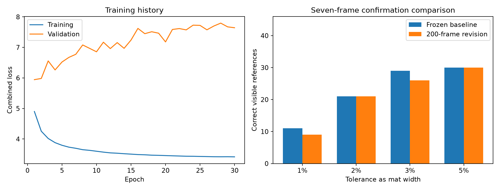

# 200-frame visual revision on BESTIJA

The 200-image dataset was visually corrected by the assistant, imported into CVAT, exported, and compared with the source revision. A fresh attention support model was trained on the RTX 5080. The new model scores below the frozen baseline at 3% tolerance; keep the baseline as the established model.

## Dataset and traceability

- CVAT job: https://app.cvat.ai/tasks/2754547/jobs/4717612
- 200 training images: original 60 plus 140 selected for time and lighting coverage; all 200 underwent the visual pass.
- 3689 dancer boxes, 3017 visible support points, 618 hidden, 50 airborne, 4 unresolved contacts.
- 12 fixed-camera floor polylines per image, 2,400 total. These are calibration guides; the rear boundary is an estimate.
- The same 11 original validation images were preserved. Source frames 3938–4092 were excluded from training.
- CVAT round-trip checks covered every frame, ID, status, support type, box, point and floor guide within 0.02 pixels. This verifies data transfer, not annotation accuracy.
- Labels are approximate assistant visual estimates, without independent human review. The four unresolved cases remain excluded from point supervision.

## Training and selection

Run: `lighting_200_visual_s17`; seed 17; 30 epochs; 420.9 seconds. ImageNet ResNet18 initialization, attention support head, brightness/crop/flip augmentation, posture-balanced sampling. 3685 usable training crops and 180 validation crops.

The replay checkpoint is `best_joint.pt` from epoch 3, selected by validation joint F1. The reportability threshold is 0.9, calibrated on the 11 validation images using the frozen crop averaging mode `crop5flip`. Selection was written before confirmation scoring. The rejected pilot was not evaluated on confirmation.

Training loss decreased while validation loss rose in later epochs, indicating overfitting. The earlier validation-selected checkpoint was retained instead of the final epoch. More training images did not produce a better 3% confirmation result in this run.

## Frozen comparison

Same cached dancer detections, tracks, full 2,424-frame temporal extent, homography and offline trajectory filter. Only the support checkpoint and validation-selected reportability threshold differ.

| Tolerance | Frozen baseline | 200-frame revision | Count change |
|---|---:|---:|---:|
| 1% | 11/46 | 9/46 | -2 |
| 2% | 21/46 | 21/46 | +0 |
| 3% | 29/46 | 26/46 | -3 |
| 5% | 30/46 | 30/46 | +0 |

Hidden references reported as measured: baseline 5/50; revision 3/50. Missing predictions count as misses. Seven correlated images from this same video contain 46 visible and 50 hidden reference contacts. This is a same-video confirmation comparison, not evidence of generalization to other choreography. The confirmation block had already been used for the published baseline; it remained excluded from this training and selection.



## Files

- `visual_labels.json`: corrected image-local labels, with assistant provenance.
- `verified_cvat_export.xml` and `cvat_visual_revision_export.zip`: actual downloaded CVAT revision.
- `cvat_roundtrip_check.json`: full transfer comparison and SHA-256 hashes.
- `training_manifest.json`: exact train/validation split and labels.
- `../runs/lighting_200_visual_s17/best_joint.pt`: new validation-selected checkpoint.
- `../runs/lighting_200_visual_s17/evaluation/results.json`: complete comparison records.
- `../runs/lighting_200_visual_s17/evaluation/lighting_trial_replay.mp4`: 97-second source-and-map replay.

The replay contains training images. Offline smoothing uses future frames. Dense occlusions and identity switches remain unresolved; do not claim reliable tracking of all 20 dancers or validated formation accuracy. Solid points represent reported measurements; hollow points represent estimates.

## Reproduce from the repository root

Use the configured CUDA Python environment on BESTIJA. The package includes the 200 PNGs in `Experiment/lighting_expansion_200/frames` and the published repository assets.

```powershell
python Experiment/lighting_expansion_200/visual_relabel/verify_cvat_revision.py Experiment/lighting_expansion_200/visual_relabel/cvat_visual_revision_export.zip --task-url https://app.cvat.ai/tasks/2754547/jobs/4717612
python Experiment/lighting_expansion_200/run_trial.py Experiment/lighting_expansion_200/visual_relabel/verified_cvat_export.xml --task-url https://app.cvat.ai/tasks/2754547/jobs/4717612 --name lighting_200_visual_reproduction_s17 --epochs 30 --expected-labels Experiment/lighting_expansion_200/visual_relabel/visual_labels.json --revision-dir Experiment/lighting_expansion_200/visual_relabel
python Experiment/lighting_expansion_200/evaluate_trial.py --name lighting_200_visual_s17 --verified-revision Experiment/lighting_expansion_200/visual_relabel
```

Reproduction of the recorded comparison uses the supplied checkpoint and selection. A fresh training run is a separate experiment; do not choose it based on the confirmation score.

## Team replay

The 0.30 replay adds display coverage using the same checkpoint and cached dancer tracks. See the research notebook for the full threshold sweep and motion checks. Formation detection is pending.
