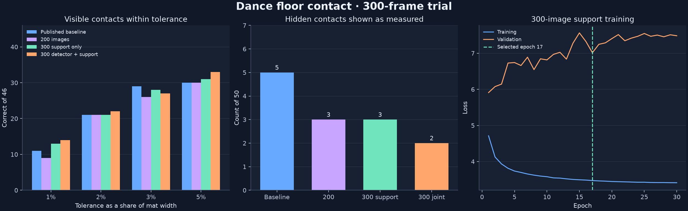

# Dance floor contact · 300-frame training results

The training set uses 300 fixed-camera source images and the original 11 validation images. A, B, and C contain 100 training images each. See [the dataset notes](DATASET.md) for review provenance, exact counts and instructions.

## Support and detector training

- The RTX 5080 trained the support head for 30 epochs in 11.1 minutes. It used ImageNet ResNet18 initialization, an attention head, posture-balanced sampling and image augmentations. Epoch 17 was selected by validation joint F1. The deployed crop-averaged reportability threshold was 0.90.
- The RTX 5080 fine-tuned the dancer detector for 15 epochs in 4.8 minutes using the existing detector checkpoint, the three overlapping crop regions, and the 300-image dataset. Ultralytics selected the checkpoint on validation. Annotation coverage in some dense frames remains incomplete.
- The previous tracker configuration, homography, and offline map fit were reused. The support-only comparison holds cached detections and tracks fixed. The joint comparison reruns the tracker with the new detector.

## Reserved floor contact comparison

| Pipeline | Within 1% | Within 2% | Within 3% | Within 5% | Hidden reported measured |
| --- | --- | --- | --- | --- | --- |
| Published baseline | 11/46 | 21/46 | 29/46 | 30/46 | 5/50 |
| 200-image revision | 9/46 | 21/46 | 26/46 | 30/46 | 3/50 |
| 300-image support with published detector | 13/46 | 21/46 | 28/46 | 31/46 | 3/50 |
| 300-image support and detector | 14/46 | 22/46 | 27/46 | 33/46 | 2/50 |

The seven reserved images are correlated samples from this choreography. The tolerance is measured as a percentage of mat width. Missing points count as misses. Hidden reports count solid measured dots for contacts that were hidden in the references. These comparisons use validation-selected thresholds. The reserved block had also been used in earlier trials. The reference labels are approximate and the comparison does not measure stable dancer identity.

## Detector comparison on development images

Eleven support validation images. These boxes cover the annotated bodies only. Both detectors use the same tiled 960-pixel inference, confidence 0.25, and merge IoU 0.55.

| Model | Predictions | IoU ≥ 0.50 | IoU ≥ 0.75 | F1 at 0.50 |
| --- | --- | --- | --- | --- |
| Published detector | 184 | 158/197 | 101/197 | 0.829 |
| 300-image detector | 203 | 173/197 | 113/197 | 0.865 |

## 0.30 display replays

| 0.30 replay | Map dots | Dots per frame | One-frame flickers | Step-change p99 |
| --- | --- | --- | --- | --- |
| 200-image revision | 35,596 | 14.68 | 9 | 0.0465 |
| 300-image support with published detector | 35,103 | 14.48 | 9 | 0.0479 |
| 300-image support and detector | 35,695 | 14.73 | 10 | 0.0489 |

Map dots include reported contacts and hollow temporal estimates. A flicker is a point appearing for just one frame or disappearing for just one frame. Step-change p99 measures the upper tail of frame-to-frame movement changes in units of 1% of mat width. These replay diagnostics include training frames and describe display behavior.

The results archive contains both 97-second replays and their map coordinates. Formation detection and dancer formation accuracy are separate project steps.
